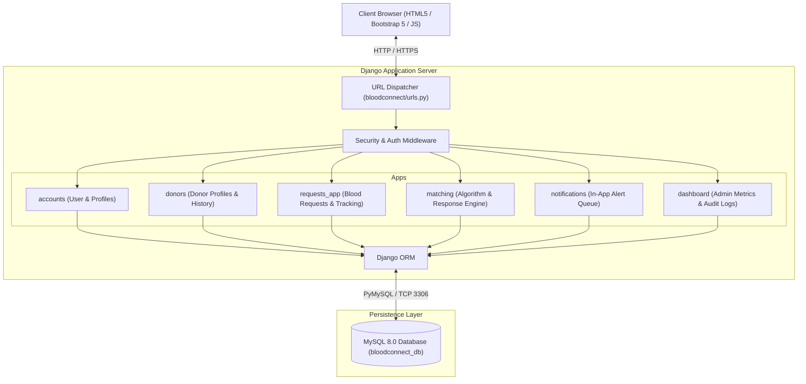
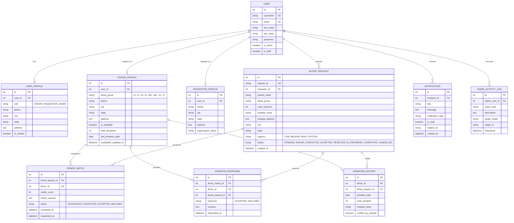
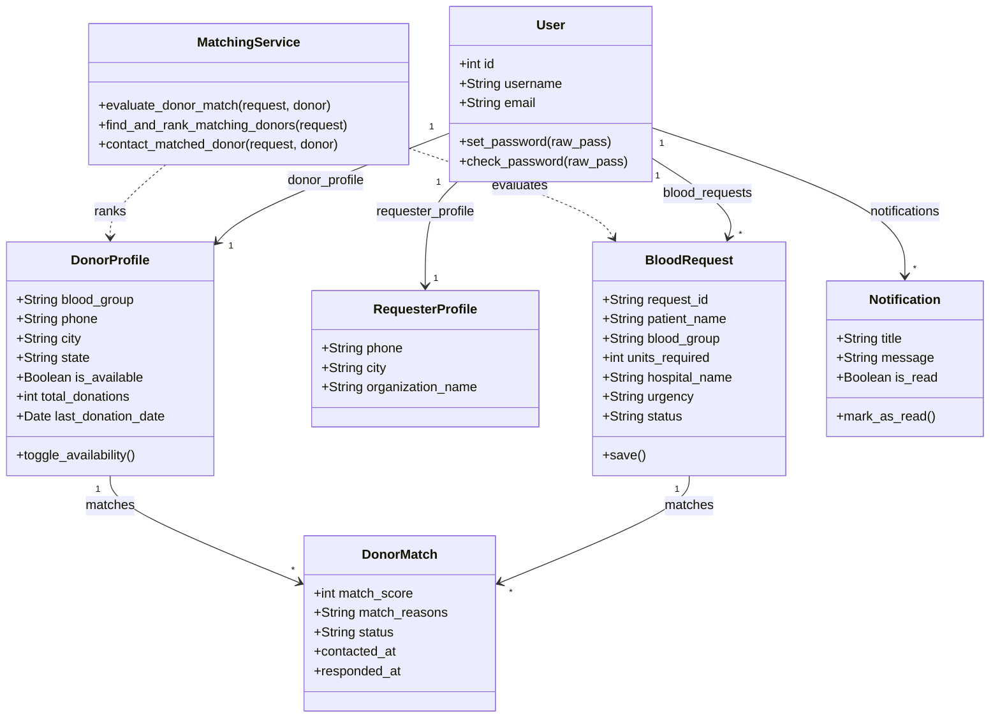
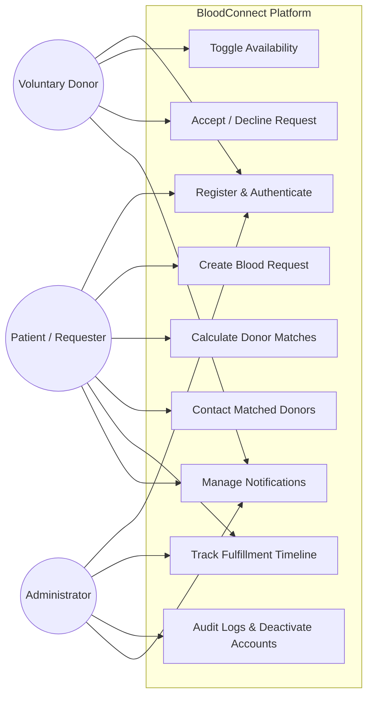
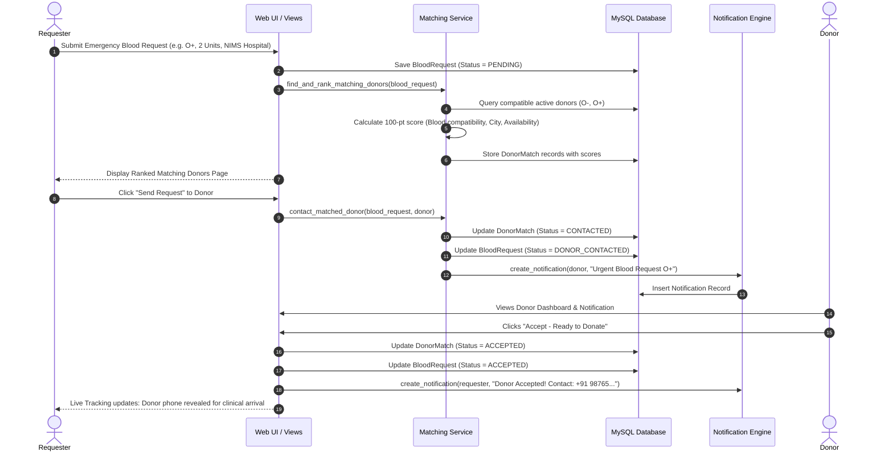
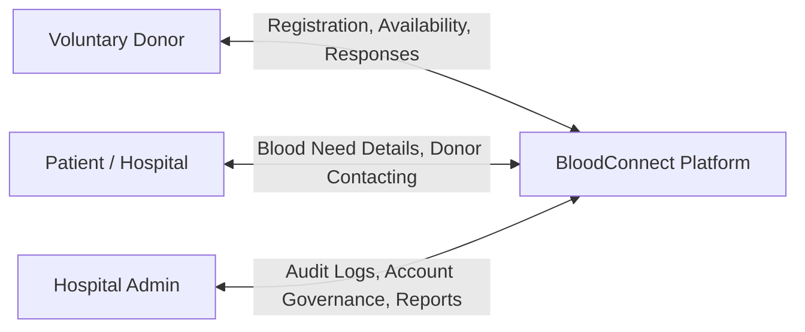
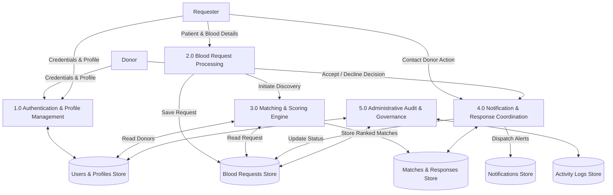
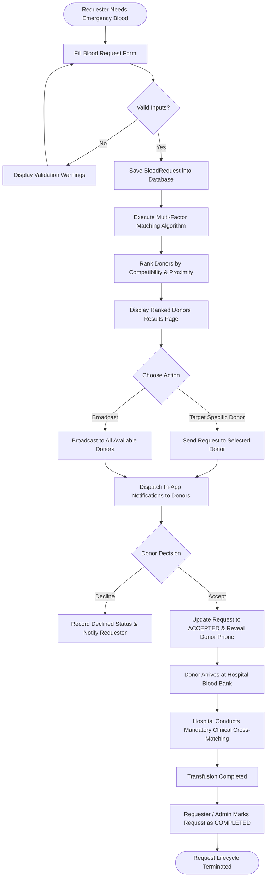

# BloodConnect: Comprehensive Software Requirements Specification (SRS) & System Architecture Diagrams

---

## 1. Software Requirements Specification (SRS)

### 1.1 Introduction
The **BloodConnect** web application is an emergency healthcare blood coordination system designed to discover and connect voluntary blood donors with patients in urgent clinical need.

### 1.2 User Classes and Characteristics
1. **Voluntary Blood Donors:** Adults aged 18-65 capable of donating blood, who register their blood group and update their availability status.
2. **Blood Requesters (Patients, Attendants, Hospitals):** Individuals or medical institutions in immediate need of blood units for surgeries or emergencies.
3. **Hospital Administrators:** Medical supervisors who monitor platform metrics, review requests, and safeguard system integrity.

### 1.3 Functional Requirements
- **FR-1 (Registration & Auth):** Users must be able to register as Donors or Requesters with input validation, duplicate email/username checking, and password strength validation.
- **FR-2 (Donor Availability):** Donors must be able to toggle their status between Available and Unavailable instantly.
- **FR-3 (Blood Request Creation):** Requesters must be able to submit emergency requests with patient name, required blood group, units, hospital address, city, and urgency level.
- **FR-4 (Compatibility-Based Matching):** System must evaluate red blood cell transfusion compatibility (ABO and Rh factor rules) and rank donors using a 100-point multi-factor score.
- **FR-5 (In-App Notifications):** System must dispatch real-time in-app alerts when requests are created, when donors are contacted, and when responses (Accept/Decline) are submitted.
- **FR-6 (Tracking & Timeline):** Requesters must be able to track request progression from Created &rarr; Contacted &rarr; Accepted &rarr; Hospital Verification &rarr; Fulfilled.
- **FR-7 (Admin Control):** Administrators must be able to view system metrics, blood distribution, manage user accounts, and review audit logs.

### 1.4 Non-Functional Requirements
- **NFR-1 (Performance):** Donor matching calculation must execute in under 1 second for active regional donor pools.
- **NFR-2 (Privacy):** Donor telephone numbers and personal addresses must remain masked until a donor explicitly accepts a request.
- **NFR-3 (Compatibility):** 100% responsive design across Desktop, Tablet, and Mobile browsers using Bootstrap 5.

---

## 2. System Architecture Diagram

---

## 3. Entity-Relationship (ER) Diagram

---

## 4. Class Diagram

---

## 5. Use Case Diagram

---

## 6. Sequence Diagram: Emergency Blood Request & Donor Acceptance

---

## 7. Data Flow Diagram (DFD)

### Level 0 DFD (Context Diagram)

### Level 1 DFD (Decomposed Processes)

---

## 8. Activity Diagram: Blood Request Lifecycle

---

## 9. Testing & Quality Assurance Documentation

The application includes 15 automated test cases covering end-to-end functionality:
1. `test_donor_registration_success`: Validates User, UserProfile, and DonorProfile atomic creation.
2. `test_requester_registration_success`: Validates RequesterProfile creation.
3. `test_duplicate_username_prevented`: Confirms unique username database validation.
4. `test_login_and_logout`: Confirms session creation and role-based redirect logic.
5. `test_donor_dashboard_accessible`: Verifies authenticated donor dashboard rendering.
6. `test_toggle_availability`: Tests instantaneous toggle between Available & Unavailable.
7. `test_add_donation_history`: Tests voluntary donation history recording and stats update.
8. `test_create_blood_request`: Tests emergency blood request generation and unique ID formatting (`REQ-YYYYMMDD-XXXXXX`).
9. `test_cancel_blood_request`: Tests requester authorization to cancel active blood requests.
10. `test_transfusion_compatibility_rules`: Validates O- universal donor and AB+ universal recipient rules across all 8 ABO/Rh blood groups.
11. `test_evaluate_donor_match_scoring`: Tests 100-point algorithm score calculation and explanation breakdown.
12. `test_contact_matched_donor_creates_notification`: Verifies notification generation upon donor outreach.
13. `test_donor_accepts_request_flow`: Tests donor acceptance decision and phone number release to requester.
14. `test_create_and_read_notification`: Tests in-app notification creation and mark-as-read mechanics.
15. `test_mark_all_read`: Tests bulk read status update.

---

## 10. Future Enhancements
1. **SMS & WhatsApp Gateway Integration:** Integrate Twilio or Gupshup for urgent SMS alerts when donors do not have active internet connections.
2. **GPS & Geolocation Mapping:** Interactive Leaflet / OpenStreetMap mapping displaying hospital locations and donor travel radii.
3. **Hospital EMR / EHR Integration:** HL7 / FHIR protocol connectors to interface directly with hospital laboratory information systems.
4. **Blood Bank Inventory Management:** Component separation tracking (Packed Red Cells, Fresh Frozen Plasma, Cryoprecipitate, and Platelets).
