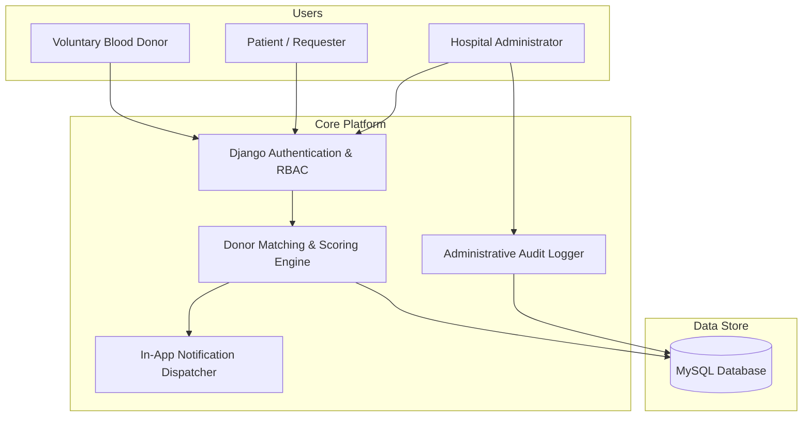

# BloodConnect – Web-Based Emergency Blood Donor Matching & Coordination System

[](https://www.python.org/)
[](https://www.djangoproject.com/)
[](https://www.mysql.com/)
[](https://getbootstrap.com/)
[]()

> **BloodConnect** is a professional, full-stack healthcare web application designed to connect voluntary blood donors with patients and hospitals in emergency situations. The platform features an intelligent, red-cell compatibility-aware matching algorithm, real-time in-app notifications, donor availability management, and an administrative oversight dashboard.

---

## 1. Project Overview

### 1.1 Problem Statement
In emergency trauma situations, high-risk surgical procedures, and pediatric intensive care, immediate access to compatible blood is critical. Traditional physical blood banks often experience acute stock shortages of specific phenotypes (especially negative Rh groups: O-, A-, B-, AB-). Families and hospital staff are frequently forced to make frantic, unstructured telephone calls to social contacts and messaging groups, losing precious minutes.

### 1.2 System Objectives
1. **Rapid Donor Discovery:** Identify suitable, available voluntary donors within minutes based on red blood cell transfusion compatibility rules and geographic location.
2. **Accountability & Privacy:** Protect voluntary donors from public telephone spam by masking contact details until a donation request is explicitly accepted.
3. **Emergency Tracking:** Enable patients, attendants, and medical staff to monitor real-time fulfillment timelines (Pending &rarr; Contacted &rarr; Accepted &rarr; In Progress &rarr; Fulfilled).
4. **Administrative Governance:** Equip hospital administrators and health authorities with tools to verify donors, audit activity logs, block suspicious accounts, and track regional blood demand metrics.

---

## 2. Technology Stack

- **Backend Framework:** Python 3.13+, Django 5.1
- **Database:** MySQL 8.0+ (managed via MySQL Workbench) / SQLite for development fallback
- **ORM:** Django Object-Relational Mapping (ORM)
- **Frontend:** HTML5, CSS3, JavaScript (ES6+), Bootstrap 5.3, Font Awesome 6 Icons
- **Environment Management:** `python-dotenv`, Python Virtual Environment (`venv`)
- **Database Driver:** `PyMySQL` with `cryptography` for seamless Windows compatibility

---

## 3. System Architecture & User Roles

BloodConnect implements role-based access control (RBAC) across three distinct user roles:



### Role Capabilities:
1. **Donor:**
   - User registration with blood group (A+, A-, B+, B-, AB+, AB-, O+, O-), city, and address.
   - Quick **Available / Unavailable** status toggle.
   - Incoming emergency request dashboard with **Accept / Decline** decision workflows.
   - Personal verified donation history logging.
   - In-app notification center.

2. **Requester:**
   - Emergency blood request submission with urgency levels (Low, Medium, High, Critical).
   - Ranked matching donor discovery engine with compatibility percentage scores.
   - Individual donor outreach and **Broadcast to All Available** capability.
   - Request timeline tracking (Created &rarr; Donors Contacted &rarr; Accepted &rarr; Hospital Verification &rarr; Fulfilled).
   - Request cancellation and completion controls.

3. **Administrator:**
   - High-level KPI metrics (Total users, donor pool by blood group, active vs completed requests).
   - Donor and requester directory management with account deactivation / activation toggles.
   - Full platform audit trail (`AdminActivityLog`).
   - Manual status overrides and integration with Django admin.

---

## 4. Donor Matching & Scoring Algorithm

The matching algorithm ranks potential donors using a multi-factor 100-point scoring formula:

1. **Red Blood Cell Compatibility (40 Points):**
   - **Exact Blood Group Match:** 40 points
   - **Compatible Transfusion Match:** 30 points (e.g., O- universal donor donating to A+ recipient)
   - **Incompatible:** 0 points (excluded from results)

2. **Donor Availability (25 Points):**
   - **Currently Available:** 25 points
   - **Unavailable:** 0 points

3. **Geographical Proximity (25 Points):**
   - **Same City:** 25 points
   - **Same State (Different City):** 15 points
   - **Interstate:** 5 points

4. **Activity & Freshness (10 Points):**
   - **Verified Past Donations:** up to 6 points
   - **Recent Status Verification (< 7 to 30 days):** up to 4 points

### Transfusion Compatibility Quick Reference:
| Recipient Group | Compatible Donor Blood Groups | Universal Status |
| :--- | :--- | :--- |
| **O-** | O- | Universal Red Cell Donor (can donate to all) |
| **O+** | O-, O+ | - |
| **A-** | O-, A- | - |
| **A+** | O-, O+, A-, A+ | - |
| **B-** | O-, B- | - |
| **B+** | O-, O+, B-, B+ | - |
| **AB-** | O-, A-, B-, AB- | - |
| **AB+** | O-, O+, A-, A+, B-, B+, AB-, AB+ | Universal Red Cell Recipient |

> **Important Medical Notice:** The BloodConnect matching system is an initial software-based locator intended solely for coordinating communication with potential donors. Software matching DOES NOT constitute clinical confirmation of compatibility. Actual blood compatibility, donor eligibility, screening, infectious disease testing, and cross-matching must be verified by qualified medical professionals or authorized blood banks.

---

## 5. Step-by-Step Installation & Setup (Windows & VS Code)

Follow these exact steps in **Windows PowerShell** to configure and run the project.

### Step 5.1: Open PowerShell in Project Directory
Open **VS Code**, press `` Ctrl + ` `` to open the integrated terminal, and ensure you are in the project folder:
```powershell
cd C:\Users\sunny\Desktop\BloodConnect
```

### Step 5.2: Virtual Environment Setup
Activate the pre-configured Python 3.13 virtual environment:
```powershell
.\venv\Scripts\Activate.ps1
```
*(If PowerShell displays an ExecutionPolicy error, run `Set-ExecutionPolicy -Scope Process -ExecutionPolicy Bypass` and then run the command above).*

### Step 5.3: Install Dependencies
```powershell
pip install -r requirements.txt
```

---

## 6. Database Setup: MySQL Configuration

BloodConnect supports **MySQL** with **MySQL Workbench** as well as local **SQLite** development mode.

### Step 6.1: Create MySQL Database via MySQL Workbench
1. Open **MySQL Workbench**.
2. Connect to your local MySQL instance (usually `localhost:3306` with user `root`).
3. Open a new SQL Query tab and execute:
```sql
CREATE DATABASE bloodconnect_db 
CHARACTER SET utf8mb4 
COLLATE utf8mb4_unicode_ci;

-- Verify database was created:
SHOW DATABASES;
```

### Step 6.2: Configure `.env` Environment File
Create or update your `.env` file in the root of `BloodConnect`:
```ini
SECRET_KEY=django-insecure-bloodconnect-super-secret-key-change-in-production-2026
DEBUG=True
ALLOWED_HOSTS=127.0.0.1,localhost

# Set DB_ENGINE to 'mysql' to connect to MySQL Workbench:
DB_ENGINE=mysql
DB_NAME=bloodconnect_db
DB_USER=root
DB_PASSWORD=your_mysql_password_here
DB_HOST=127.0.0.1
DB_PORT=3306
```
*(Note: If you leave `DB_ENGINE=sqlite`, the application seamlessly uses local SQLite storage without requiring MySQL service running).*

---

## 7. Database Migrations & Demo Data Seeding

### Step 7.1: Apply Schema Migrations
```powershell
python manage.py makemigrations
python manage.py migrate
```

### Step 7.2: Seed Realistic Demo Data
We have provided a comprehensive demo data seeder command that automatically populates the database with test donors across all 8 blood groups, active requesters, emergency requests, and administrator accounts:
```powershell
python manage.py seed_data
```

### Step 7.3: Pre-Configured Test Credentials:
| Role | Username | Password | Notes |
| :--- | :--- | :--- | :--- |
| **Administrator** | `admin` | `Admin@12345` | Full staff and superuser access |
| **Donor (O+)** | `rahul_sharma` | `Donor@12345` | Available, 4 past donations (Hyderabad) |
| **Donor (O-)** | `sneha_patel` | `Donor@12345` | Universal donor, available (Hyderabad) |
| **Donor (A+)** | `vikram_reddy` | `Donor@12345` | Available (Secunderabad) |
| **Donor (B+)** | `ananya_sen` | `Donor@12345` | Available (Hyderabad) |
| **Requester** | `arun_kumar` | `Requester@12345` | Patient family representative |
| **Hospital Coordinator** | `care_hospital_coord` | `Requester@12345` | Care Hospital blood bank |

---

## 8. Running the Application & Automated Tests

### Step 8.1: Run the Automated Test Suite
Run the 15 end-to-end automated unit and integration tests:
```powershell
python manage.py test
```
*Expected output: `Ran 15 tests ... OK`*

### Step 8.2: Start the Django Development Server
```powershell
python manage.py runserver
```

Open your browser and navigate to:
```
http://127.0.0.1:8000/
```

---

## 9. Complete Page Directory (All 18 Required Pages)

1. **Home Page:** `http://127.0.0.1:8000/`
2. **About Us:** `http://127.0.0.1:8000/about/`
3. **How It Works:** `http://127.0.0.1:8000/how-it-works/`
4. **Donor Registration:** `http://127.0.0.1:8000/accounts/register/donor/`
5. **Requester Registration:** `http://127.0.0.1:8000/accounts/register/requester/`
6. **Login:** `http://127.0.0.1:8000/accounts/login/`
7. **Donor Dashboard:** `http://127.0.0.1:8000/donor/dashboard/`
8. **Requester Dashboard:** `http://127.0.0.1:8000/requests/dashboard/`
9. **Create Blood Request:** `http://127.0.0.1:8000/requests/create/`
10. **Matching Donor Results:** `http://127.0.0.1:8000/matching/<request_id>/matches/`
11. **Notifications Center:** `http://127.0.0.1:8000/notifications/`
12. **Request Tracking:** `http://127.0.0.1:8000/requests/<request_id>/track/`
13. **Donation History:** `http://127.0.0.1:8000/donor/history/`
14. **Profile Management:** `http://127.0.0.1:8000/accounts/profile/`
15. **Admin Dashboard:** `http://127.0.0.1:8000/admin-dashboard/`
16. **Contact Us:** `http://127.0.0.1:8000/contact/`
17. **Privacy Policy:** `http://127.0.0.1:8000/privacy/`
18. **Terms and Conditions:** `http://127.0.0.1:8000/terms/`

---

## 10. Troubleshooting Common Issues

1. **Execution Policy Error in PowerShell (`cannot be loaded because running scripts is disabled`):**
   ```powershell
   Set-ExecutionPolicy -Scope Process -ExecutionPolicy Bypass
   .\venv\Scripts\Activate.ps1
   ```
2. **Access Denied / MySQL Password Error:**
   Ensure the password in `.env` (`DB_PASSWORD`) exactly matches your MySQL root password. Alternatively, switch `DB_ENGINE=sqlite` to run immediately on SQLite.
3. **Port 8000 Already In Use:**
   ```powershell
   python manage.py runserver 8080
   ```
   and access `http://127.0.0.1:8080/`.

---

## 11. License & Academic Disclaimer
Developed for academic Computer Science engineering project requirements. 100% software-based emergency coordination platform.
